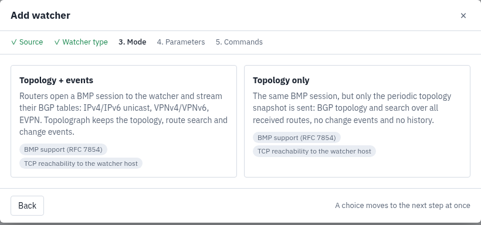
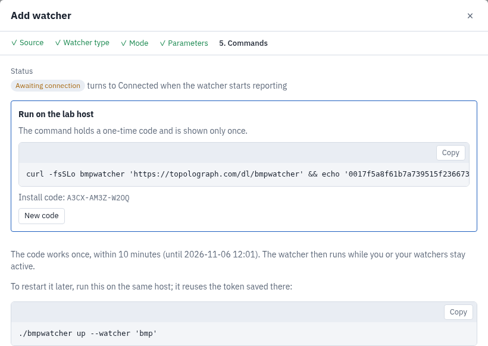

# BGP Topology Watcher (BMP Watcher)
BMP Watcher logs BGP control-plane changes for network engineers. It works as a passive BMP station: routers open a BMP session towards it and stream their BGP tables; the watcher never peers with a router and never connects to one. It collects IPv4/IPv6 unicast, VPNv4/VPNv6 and EVPN routes and sends them to Topolograph as a BGP graph, then sends every later change as an event.

| Mode | What Topolograph shows | Where it runs | Demo |
|---|---|---|---|
| Topology + events | BGP and EVPN sessions and routes, route search, and every change as an event | topolograph.com, one command | [video](https://topolograph.com/videos/4-bmp.mp4) |
| Topology only | BGP and EVPN sessions and routes, route search; no events | topolograph.com, one command; or your own Topolograph from [topolograph-docker](https://github.com/Vadims06/topolograph-docker), docker compose | [video](https://topolograph.com/videos/7-bmp-topology.mp4) |

## Logged BGP changes:
* BGP peer Up/Down
* Routes added, changed and withdrawn, per family:
  * IPv4 and IPv6 unicast
  * VPNv4 and VPNv6, with RD and route targets
  * EVPN route types 1-5 (RFC 7432, RFC 9136): MAC, IP, VNI, L3VNI, ESI, Ethernet Tag, VTEP
* EVPN MAC moves between VTEPs
* Pre-policy, post-policy and Loc-RIB (RFC 9069) observations are kept apart, so a route the router rejected is never shown as installed

## Architecture
```
routers --BMP (TCP 11019)--> bmpwatcher --snapshot and events--> Topolograph
```
When a BMP session starts, the router replays its whole table. BMP Watcher collects that replay into one snapshot of the table, sends it to Topolograph, and only then reports changes as events. In **Topology only** mode it sends snapshots only, no events. One watcher serves several BMP speakers, for example both route reflectors of a fabric.

## BGP topology on its own, or BGP over OSPF / IS-IS
**BGP only.** No OSPF or IS-IS graph is needed. The BGP graph is a row of its own in the graphs list, protocol BGP, named after the collector: open it to see the BGP sessions and search the routes.

**BGP over OSPF / IS-IS.** When at least 80% of the BGP speakers' Router IDs are nodes of one of your OSPF or IS-IS graphs, Topolograph binds the BGP graph to it. The BGP sessions are then drawn over that graph, and the separate BGP row leaves the list. BGP and EVPN questions are asked on the IGP graph: where a host is, which leaves carry a VNI, did a MAC move, what is the underlay path to a VTEP. See the [BMP Watcher guide](https://docs.topolograph.com/monitoring/bmp-watcher/#evpn). With fewer matching Router IDs, the BGP graph stays a row of its own.

An OSPF Watcher and a BMP Watcher on the same network are two watchers on the Monitoring page, but one graph: BGP is shown over the OSPF graph, not on a second graph. The OSPF graph can also be an uploaded LSDB.

## Quick start: topolograph.com
Watchers with live events and event history run on [topolograph.com](https://topolograph.com). They are free.

1. Sign in, open **Monitoring** and press **+ Add watcher**.
2. Choose **BMP Watcher**, the mode (**Topology + events** or **Topology only**), and enter the watcher host address as the routers reach it.
3. Run the command the page shows on a Linux x86_64 host; root is not needed. It downloads the watcher, checks its SHA-256 and starts it with a one-time code. The code works once, within 10 minutes.
4. Point BMP on your routers to `<host-ip>:11019`, as in the example on the same page. The watcher turns **connected** on the Monitoring page.

 

A watcher works together with Topolograph: it sends its data there and stops when Topolograph is unreachable or its token has ended.

No events on the dashboard? Start with [Troubleshooting](#troubleshooting).

## Quick start: Topology only on your own Topolograph
1. On a Docker host, install Topolograph:
    ```bash
    curl -O https://raw.githubusercontent.com/Vadims06/topolograph-docker/master/install.sh
    chmod +x install.sh
    sudo ./install.sh
    ```
2. In your Topolograph open **Monitoring**, press **+ Add watcher**, choose **BMP Watcher**, **Topology only**, and enter the watcher host address as the routers reach it.
3. On a Linux host with Docker, Docker Compose v2, git and curl, run the two commands the page shows. The first downloads this repository. The second, `sudo ./configure.sh --url <topolograph-url> --token <watcher-token>`, fetches the watcher's settings from Topolograph, writes `.env` and starts the collector with docker compose.
4. Point BMP on your routers to `<host-ip>:11019`, see [Router configuration](#router-configuration).

## Router configuration
The **+ Add watcher** page shows the router configuration with your watcher host address filled in. Point BMP on every monitored router to `<host-ip>:11019`. Enable pre- and post-policy monitoring where the platform offers it. For EVPN, enable BMP on the route reflectors: they hold every leaf's routes, while a leaf exports only what it learned.

**FRR** (EVPN verified). FRR loads BMP as a module: add `-M bmp` to `bgpd_options` in `/etc/frr/daemons` and restart FRR.
```
router bgp <asn>
 bmp targets topolograph
  bmp connect <host-ip> port 11019 min-retry 1000 max-retry 2000
  bmp monitor ipv4 unicast pre-policy
  bmp monitor ipv4 unicast post-policy
  bmp monitor ipv6 unicast pre-policy
  bmp monitor ipv6 unicast post-policy
  bmp monitor ipv4 vpn pre-policy
  bmp monitor ipv4 vpn post-policy
  bmp monitor l2vpn evpn pre-policy
  bmp monitor l2vpn evpn post-policy
```
**Cisco IOS-XR**
```
bmp server 1
 host <host-ip> port 11019
 description topolograph
!
router bgp <asn>
 neighbor 10.0.0.2
  bmp-activate server 1
```
**Juniper Junos**
```
routing-options {
    bmp {
        station topolograph {
            station-address <host-ip>;
            station-port 11019;
            route-monitoring { pre-policy; post-policy; }
        }
    }
}
```
**Nokia SR OS**
```
configure router bgp
    monitor
        admin-state enable
        station "topolograph"
            admin-state enable
            router-monitoring pre-policy
            router-monitoring post-policy
```
The syntax for IOS-XR, Junos and SR OS is indicative; check your release notes for the exact keywords.

## Watcher host
* Linux x86_64 host; root is not needed. Topology only with docker compose: Docker, Docker Compose v2, git, curl and sudo
* The BMP TCP port (11019 by default) is open from the routers
* Access to Topolograph: topolograph.com over HTTPS, or your own Topolograph over HTTP

## Run, restart, stop
On topolograph.com:
* The first start uses the command from the **+ Add watcher** page with its one-time code.
* Restart with the saved token: `./bmpwatcher up --watcher <name>`.
* Stop with Ctrl-C. The watcher also stops by itself when its token ends or is refused, or when it cannot reach Topolograph for longer than its lease.

Topology only with docker compose: the containers restart by themselves after a crash or a reboot, as long as Docker starts at boot (`systemctl enable docker`). Stop them with `docker compose --profile collector down` in the download folder. After changing answers on the watcher page, run `configure.sh` again.

## Check it on Topolograph
The first snapshot goes out once every router has replayed its table: about 30 seconds after its routes stop arriving, at most 5 minutes after the first one. The watcher then prints `topology posted`. In Topolograph open the BGP graph from the graphs list, or, when it is bound to your OSPF or IS-IS graph, that graph: its BGP overlay shows the sessions, and **Graph table → BGP Routes** the routes (see [BGP topology on its own, or BGP over OSPF / IS-IS](#bgp-topology-on-its-own-or-bgp-over-ospf--is-is)). EVPN underlay questions need the IGP graph: upload the LSDB of your network or run [OSPF Watcher](https://github.com/Vadims06/ospfwatcher) / [IS-IS Watcher](https://github.com/Vadims06/isiswatcher). Every Topolograph account also holds a demo BGP graph.

## Troubleshooting
##### Symptoms
The router has no BMP session with the watcher.

##### Steps:
1. BMP is opened by the router. Check that the router reaches `<host-ip>:11019`, and that the watcher listens: `ss -lntp | grep 11019`.
2. FRR: `show bmp` must show the target `Up`. If the `bmp` commands are rejected, `-M bmp` is missing in `/etc/frr/daemons`.

##### Symptoms
The BMP session is up, but no BGP graph appears on Topolograph.

##### Steps:
1. No `topology posted` line yet: on FRR, `show bmp` shows `MonSent 0` until the router starts sending its table. With BMP added to a running FRR this was seen to take up to 5 minutes after the session came up.
2. The watcher exits saying the token ended or was refused. On topolograph.com, start it again from the **+ Add watcher** page with a new one-time code. With docker compose, run the commands from the watcher page again.

### Topolograph suite
* OSPF Watcher [link](https://github.com/Vadims06/ospfwatcher)
* IS-IS Watcher [link](https://github.com/Vadims06/isiswatcher)
* BMP Watcher [link](https://github.com/Vadims06/bmpwatcher)
* Topolograph [link](https://github.com/Vadims06/topolograph)
* Topolograph in docker [link](https://github.com/Vadims06/topolograph-docker)

### Feedback
* https://t.me/topolograph
* admin at topolograph.com

### License
The `bmpwatcher` binary is licensed under its EULA, published with each release next to the binary. BMP Watcher is derived from [gobmp](https://github.com/sbezverk/gobmp) (Apache License 2.0).
